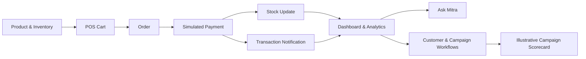

<div align="center">

# MerchantMitra

### A retail operations platform and business copilot for India's local retailers

**Billing · Inventory · Customer Intelligence · Campaigns · Business Insights**


[](https://www.python.org/)
[](https://fastapi.tiangolo.com/)
[](https://react.dev/)
[](https://www.typescriptlang.org/)
[](https://www.sqlite.org/)
[](#prototype-boundaries)

[Explore the code](https://github.com/abhishekbagi262/Merchant_Mitra) · [Report an issue](https://github.com/abhishekbagi262/Merchant_Mitra/issues)

</div>

---

## Overview

MerchantMitra is a retail operations prototype built around the day-to-day needs of small Indian retailers. It brings together point-of-sale billing, inventory tracking, customer records, loyalty workflows, campaign planning and a conversational business assistant in one application.

The project is designed to demonstrate how a retailer can move from recording transactions to understanding what is happening in the store. Its dashboard and assistant use application data for business figures; optional local language-model support is used for natural-language responses, with deterministic fallbacks when the local model is unavailable.

> **Project boundary:** MerchantMitra is a demonstration prototype. UPI payments, customer campaign delivery and campaign outcome measurements are simulated; it is not connected to a live payment gateway or messaging provider.

## What it includes

| Area | Capabilities |
|---|---|
| **Point of sale** | Product search, cart management, discount validation, order totals and transaction workflow |
| **Payment demonstration** | Transaction-specific demo UPI QR and simulated success, failure and cancellation outcomes |
| **Inventory** | Stock adjustments, movement history, reorder thresholds and estimated days of stock cover |
| **Customers** | Customer records, purchase history, customer segments and loyalty coupon workflows |
| **Business insights** | Sales and profit metrics, product performance, customer activity and low-stock indicators |
| **Notifications** | Purchase notifications, high-value sale alerts, stock alerts and profit-decline warnings with read/unread state |
| **Campaigns** | Campaign drafting, margin checks, approval confirmation, treatment/holdout assignment and an illustrative scorecard |
| **Ask Mitra** | Natural-language questions answered using controlled, database-backed business queries |
| **Languages** | English, Hindi and Kannada interface and business brief content |
| **Audit trail** | Local event history for important application actions |

## Product workflow

The application connects the main retail workflow from sale to follow-up:



## Key engineering decisions

- **Database-backed business figures:** sales, inventory and customer metrics are calculated from application records rather than invented by the language model.
- **Decimal-safe pricing:** monetary calculations use Python's `Decimal` type and database numeric fields.
- **Duplicate-safe payment simulation:** repeated processing of the same successful payment is guarded to avoid duplicate stock deductions and inflated revenue.
- **Explicit campaign approval:** campaign execution requires a review and approval step.
- **Holdout experiment demonstration:** a 90/10 treatment-to-holdout split is used to demonstrate incremental campaign measurement.
- **Graceful assistant fallback:** Ask Mitra attempts to use a local Ollama model when enabled; deterministic response logic remains available when Ollama is disabled or unreachable.
- **Persistent notifications:** purchase and operational events are stored and can be marked read individually or in bulk.

## Technology

| Layer | Tools |
|---|---|
| Backend API | Python 3.11+, FastAPI, Pydantic |
| Data access | SQLAlchemy |
| Database | SQLite by default |
| Frontend | React 18, TypeScript 5, Vite |
| UI and charts | Tailwind CSS, Recharts, Lucide |
| Assistant integration | Optional local Ollama through HTTP |
| QR generation | qrcode and Pillow |
| Testing | Pytest and HTTPX |

## Run locally

### Prerequisites

- Python 3.11 or newer
- Node.js 18 or newer
- npm

### 1. Clone the repository

```bash
git clone https://github.com/abhishekbagi262/Merchant_Mitra.git
cd Merchant_Mitra
```

### 2. Set up the backend

**Windows PowerShell**

```powershell
cd backend
python -m venv .venv
.\.venv\Scripts\Activate.ps1
pip install -r requirements.txt
python -m uvicorn app.main:app --host 127.0.0.1 --port 8000 --reload
```

**macOS / Linux**

```bash
cd backend
python3 -m venv .venv
source .venv/bin/activate
pip install -r requirements.txt
python -m uvicorn app.main:app --host 127.0.0.1 --port 8000 --reload
```

The API starts at `http://127.0.0.1:8000`.

Interactive API documentation: `http://127.0.0.1:8000/docs`

Health check: `http://127.0.0.1:8000/api/health`

### 3. Set up the frontend

Open a second terminal:

```bash
cd frontend
npm install
npm run dev
```

The Vite development server is configured for `http://localhost:3000` and proxies `/api` requests to the backend on port 8000.

### 4. Optional local language model

Ask Mitra can attempt to use a local Ollama service. Configure the following environment values for the backend:

```env
OLLAMA_BASE_URL=http://localhost:11434
OLLAMA_MODEL=llama3
USE_OLLAMA_IF_AVAILABLE=true
```

If Ollama is not running or does not respond within the configured timeout, the application falls back to its deterministic response logic. The local model is optional.

## Run the tests

The repository contains backend tests for product and stock operations, pricing, simulated payments, analytics, customer workflows, campaigns, audit events, assistant responses and notifications.

**Windows PowerShell**

```powershell
cd backend
.\.venv\Scripts\Activate.ps1
$env:PYTHONPATH = (Get-Location).Path
python -m pytest tests -v
```

**macOS / Linux**

```bash
cd backend
PYTHONPATH=. python -m pytest tests -v
```

The test files currently define 26 test functions. Run the commands above to obtain the result for your local environment.

## Prototype boundaries and responsible use

The following flows are intentionally simulated and must not be mistaken for live integrations:

| Capability | Current implementation |
|---|---|
| UPI payment | Demo QR and simulated payment outcomes; no funds are transferred |
| Payment confirmation | Local application simulation; no payment-provider webhook |
| Customer messaging | Simulated delivery state; no WhatsApp or SMS is sent |
| Campaign measurement | Deterministic synthetic scorecard; not measured customer behaviour |
| Seven-day observation | Demonstration fast-forward; no real calendar wait |
| Business assistant | Database-backed intent handling with optional local Ollama; not a financial or legal adviser |

The demo uses seeded sample retailer data. Do not use it as a live point-of-sale or accounting system without production-grade authentication, authorization, security review, operational monitoring, payment-provider integration and data-protection controls.

## Repository layout

```text
Merchant_Mitra/
├── backend/
│   ├── app/
│   │   ├── models/        # SQLAlchemy models
│   │   ├── routers/       # FastAPI route handlers
│   │   ├── schemas/       # Pydantic request/response schemas
│   │   ├── services/      # Pricing, inventory, payments, analytics, AI
│   │   ├── config.py
│   │   ├── database.py
│   │   └── main.py
│   ├── tests/
│   └── requirements.txt
├── frontend/
│   ├── src/
│   │   ├── api/
│   │   ├── components/
│   │   ├── i18n/
│   │   └── pages/
│   └── package.json
├── .env.example
├── start_backend.bat
├── start_frontend.bat
└── README.md
```

## Roadmap

- Add real authentication and role-based access control.
- Integrate a payment provider using verified server-side webhooks.
- Connect an approved messaging provider for customer communication.
- Move from the demo SQLite setup to a managed production database.
- Add deployment, monitoring, backup and security hardening.
- Expand automated tests and add reproducible frontend test coverage.

## Author

**Abhishek Bagi** — Information Science and Engineering student, interested in backend engineering and applied AI.

[GitHub](https://github.com/abhishekbagi262) · [LinkedIn](https://www.linkedin.com/in/abhishek-bagi-262abhi)

---

<div align="center">
  <sub>Built to explore practical retail workflows, reliable data handling and useful AI assistance.</sub>
</div>
